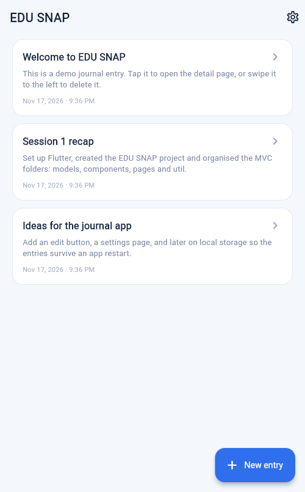
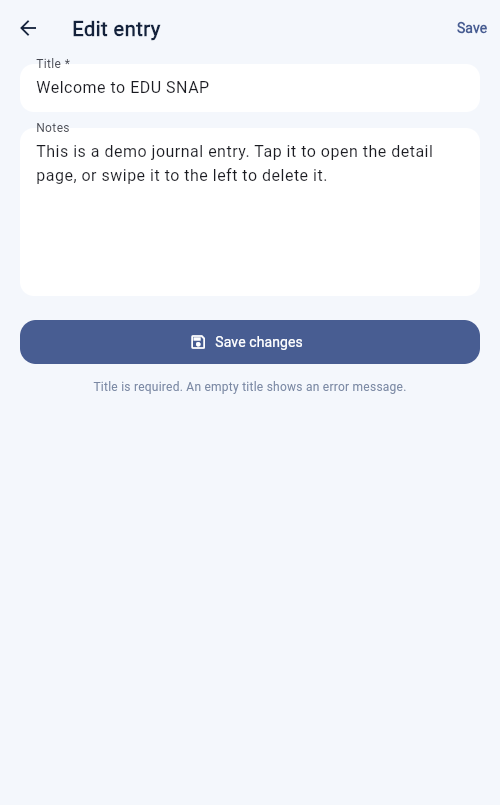
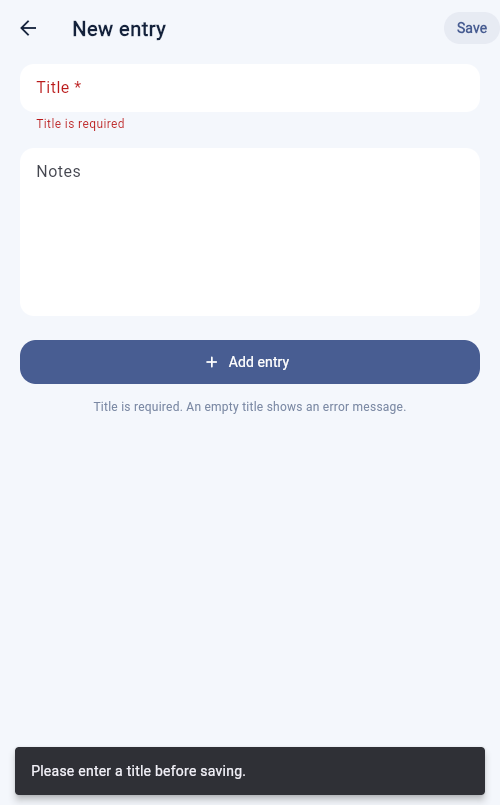

# EDU SNAP

A Flutter demo app built during the **Mobile App Development with Flutter**
workshop (EDUHK, Itchi Technology Limited), structured with the MVC layout
taught in Session 1 and extended into a small journal app in Session 2.

## Screens

| Home (list) | Detail |
|---|---|
|  |  |

| Edit (challenge) | Validation error (homework) |
|---|---|
|  |  |

## Folder structure

```
lib/
├── main.dart                    # entrance only: opens the home page
├── models/                      # data classes only (no widgets, no network)
│   └── journal_entry.dart
├── components/                  # reusable widgets
│   ├── journal_card.dart
│   └── primary_button.dart
├── pages/                       # one folder per page: view + controller
│   ├── home_page/               # list, sorting, swipe to delete
│   ├── detail_page/             # one entry + edit / delete actions
│   ├── add_page/                # create, also reused as the edit page
│   ├── setting_page/            # placeholder, extended in later sessions
│   └── landing_page/            # Session 1 screen (kept for reference)
└── util/                        # shared helpers
    ├── app_theme.dart
    ├── date_formatter.dart
    ├── journal_repository.dart  # in-memory data source (ChangeNotifier)
    └── network_controller.dart
```

## MVC in one line

* **Model** – plain data (`JournalEntry`)
* **View** – what the user sees (`*_view.dart`)
* **Controller** – page state and logic (`*_controller.dart`, a `ChangeNotifier`)

## Session 2 features

* Lifecycle: data loads and the first sort happen in the home page `initState`,
  listeners are removed in `dispose`.
* Home page is a list sorted by title (descending) and refreshed after every
  create / update.
* Detail page receives the tapped entry, shows title, notes and timestamps.
* Add page has a required-field validation: an empty title shows an inline
  error **and** a floating snack bar (the homework asked for our own error
  style instead of the workshop's alert dialog).
* Swipe an entry to the left to delete it, with a confirmation dialog.
* Settings page reachable from the app bar (icon buttons, as requested).
* **Challenge:** the edit action is implemented by reusing the add page – it
  opens pre-filled with the entry, saving updates it, and the detail page shows
  the updated data immediately.

## Run it

```bash
flutter pub get
flutter run          # choose a device, e.g. Chrome or Windows
flutter test         # widget tests: list, validation, create, edit
```

## Session checklists

**Session 1**

- [x] Flutter project created
- [x] MVC folders (`models`, `components`, `pages`, `util`)
- [x] Landing page (view + controller)
- [x] Home page (view + controller)
- [x] Committed and pushed to GitHub

**Session 2**

- [x] Home page turned into a journal list
- [x] Detail page (view + controller)
- [x] Add page (view + controller)
- [x] Setting page (view + controller)
- [x] Form validation with our own error message
- [x] Swipe to delete with confirmation
- [x] Title sorting on load and after add / edit
- [x] Challenge: edit an existing entry through the add page
