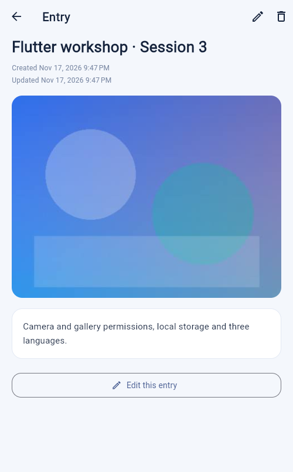
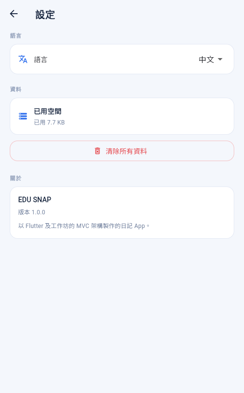
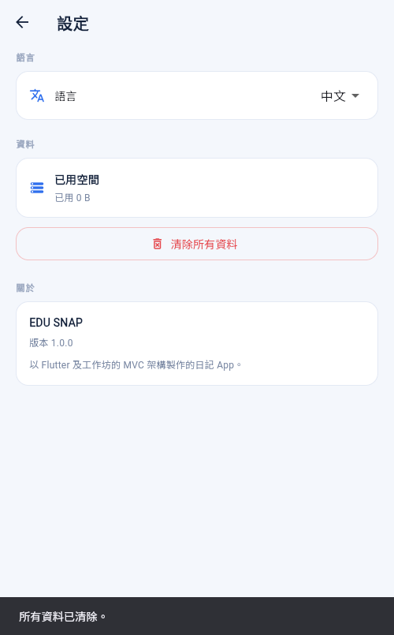

# EDU SNAP

A Flutter journal app built during the **Mobile App Development with Flutter**
workshop (EDUHK, Itchi Technology Limited), structured with the MVC layout
taught in Session 1, turned into a journal in Session 2 and completed in
Session 3 with photos, local storage and three languages.

## Screens

| Home (list with photos) | Detail |
|---|---|
|  |  |

| Settings (storage + language) | Settings in Chinese | After clearing |
|---|---|---|
|  |  |  |

## Folder structure

```
lib/
├── main.dart                    # entrance only: opens the home page
├── l10n/                        # app_en.arb / app_zh.arb / app_ja.arb
├── models/                      # data classes only (no widgets, no network)
│   └── journal_entry.dart
├── components/                  # reusable widgets
│   └── journal_card.dart
├── pages/                       # one folder per page: view + controller
│   ├── home_page/               # list, sorting, swipe to delete
│   ├── detail_page/             # one entry + edit / delete actions
│   ├── add_page/                # create + edit, with photo picker
│   └── setting_page/            # language, storage used, clear data
└── util/                        # shared helpers
    ├── app_theme.dart
    ├── date_formatter.dart      # localized dates
    ├── journal_repository.dart  # in-memory data, persisted to storage
    ├── local_storage.dart       # shared_preferences wrapper + size
    ├── locale_controller.dart   # language state
    ├── network_controller.dart
    └── photo_service.dart       # image_picker + permission_handler
```

## MVC in one line

* **Model** – plain data (`JournalEntry`)
* **View** – what the user sees (`*_view.dart`)
* **Controller** – page state and logic (`*_controller.dart`, a `ChangeNotifier`)

## Session 2 features

* Lifecycle: load + first sort in the home page `initState`, listeners removed
  in `dispose`.
* List sorted by title (descending), refreshed after create / update.
* Detail page, add page and settings page, each with its own view + controller.
* Required-field validation with an inline error **and** a floating snack bar.
* Swipe left to delete with a confirmation dialog.
* **Challenge:** edit an existing entry by reusing the add page pre-filled.

## Session 3 features

* **Permissions:** `permission_handler` checks camera / photo access *before*
  opening the picker; a denied permission explains why and offers a shortcut to
  the system settings.
* **Photos:** `image_picker` opens the camera or the gallery, the picked image is
  stored as base64 inside the entry (not a gallery path, so it survives the
  original being deleted) and shown in the list and on the detail page.
* **Local storage:** `shared_preferences` keeps the journal (text + photo data)
  and the chosen language, loaded once in `initState`.
* **Localization:** English, Chinese and Japanese through ARB files, with
  placeholders (dates, storage size) formatted per language.
* **Settings:** language drop-down, real "storage used" size and a clear button
  guarded by a **double confirmation**.

### Session 3 challenges

- [x] Storage size calculated from the real stored data (text **and** photos)
- [x] Size shown with a localized placeholder (`7.7 KB used` / `已用 7.7 KB`)
- [x] Clear-all button with double confirmation, size drops to `0 B`
- [x] More than two languages, selected from a drop-down
- [x] Language choice remembered in local storage
- [x] Empty state hint when the journal has no entries

## Run it

```bash
flutter pub get
flutter gen-l10n      # regenerates lib/l10n/app_localizations*.dart
flutter run           # Chrome or Windows for a quick look
flutter test          # widget tests: list, validation, create, edit, i18n, clear
```

> Building for Android / iOS / Windows needs the platform toolchains and, on
> Windows, **Developer Mode** enabled (Flutter creates plugin symlinks).
