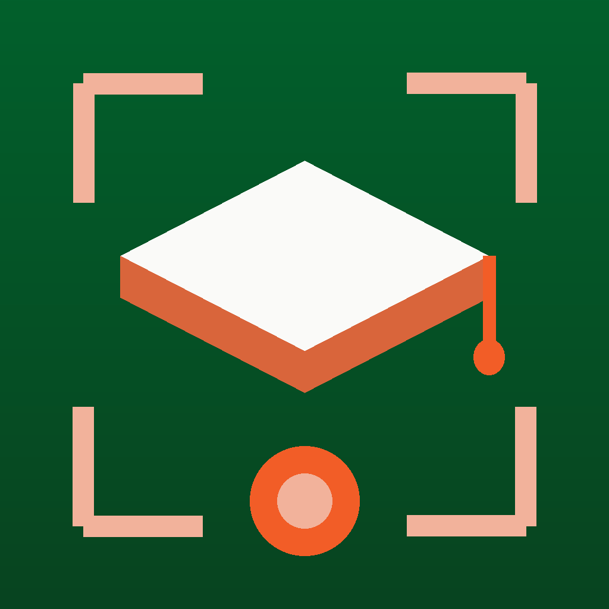
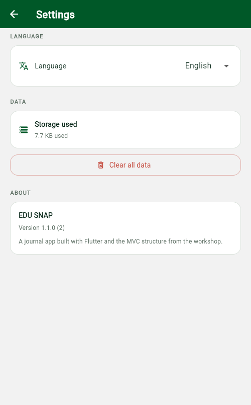
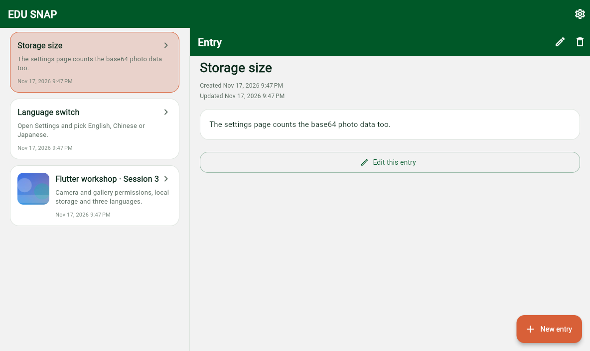

# EDU SNAP

A Flutter journal app built during the **Mobile App Development with Flutter**
workshop (EDUHK, Itchi Technology Limited). Four sessions: MVC structure,
journal pages, photos + local storage + three languages, and finally icon,
theme, version and a native iPhone Duo plugin.

<p align="left">
  
</p>

## Screens

| Home (list with photos) | Detail |
|---|---|
|  |  |

| Settings (storage, version, language) | Settings in Chinese | After clearing |
|---|---|---|
|  |  |  |

| Two-pane layout (iPhone Duo fully open / wide window) |
|---|
|  |

## Folder structure

```
assets/
├── icon.png                     # 1024x1024 source icon
└── icon_foreground.png          # Android adaptive foreground
lib/
├── main.dart                    # entrance only: opens the home page
├── l10n/                        # app_en.arb / app_zh.arb / app_ja.arb
├── models/                      # data classes only (no widgets, no network)
│   └── journal_entry.dart
├── components/                  # reusable widgets
│   └── journal_card.dart
├── pages/                       # one folder per page: view + controller
│   ├── home_page/               # list + two-pane host
│   ├── detail_page/             # one entry, edit / delete, Duo rail back
│   ├── add_page/                # create + edit, with photo picker
│   └── setting_page/            # language, storage, version, clear data
└── util/                        # shared helpers
    ├── app_theme.dart           # palette (ThemeExtension) + ThemeData
    ├── date_formatter.dart      # localized dates
    ├── duo_layout_service.dart  # iPhone Duo side rail + fold stream
    ├── journal_repository.dart  # in-memory data, persisted to storage
    ├── local_storage.dart       # shared_preferences wrapper + size
    ├── locale_controller.dart   # language state
    ├── network_controller.dart
    └── photo_service.dart       # image_picker + permission_handler
```

## MVC in one line

* **Model** – plain data (`JournalEntry`)
* **View** – what the user sees (`*_view.dart`)
* **Controller** – page state and logic (`*_controller.dart`, a `ChangeNotifier`)

## Session 2 — pages & lifecycle

* Load + first sort in the home page `initState`, listeners removed in `dispose`.
* List sorted by title (descending), refreshed after create / update.
* Detail page, add page and settings page, each with its own view + controller.
* Required-field validation with an inline error **and** a floating snack bar.
* Swipe left to delete with a confirmation dialog.
* **Challenge:** edit an existing entry by reusing the add page pre-filled.

## Session 3 — photos, storage, languages

* `permission_handler` checks camera / photo access before the picker opens; a
  denial explains why and offers a shortcut to the system settings.
* `image_picker` stores the picked image as base64 inside the entry (not a
  gallery path), shown in the list and on the detail page.
* `shared_preferences` keeps the journal (text + photo data) and the language.
* English / Chinese / Japanese ARB localisation with placeholders.
* Settings shows the real storage size and clears everything behind a
  **double confirmation** (size drops back to `0 B`).
* Challenges: localized size placeholder, three languages in a drop-down,
  language remembered, empty-state hint.

## Session 4 — icon, theme, version, native plugin

**App icon** — one 1024×1024 `assets/icon.png` (mortarboard + viewfinder in the
brand colours) plus an adaptive foreground, expanded by
`flutter_launcher_icons` into every Android density and every iOS size:

```bash
dart run flutter_launcher_icons
```

**Theme** — the palette is sampled from the icon and applied once in
`AppTheme`; widgets read it through `context.palette`, no hex values in pages.

| Role | Colour |
|---|---|
| Primary | `#005828` |
| Secondary | `#D86038` |
| Accent | `#F2653A` |
| Surface (logo peach) | `#F0B098` |
| Background | `#F2F2F2` |

**Version** — `package_info_plus` reads `version: 1.1.0+2` from `pubspec.yaml`;
the settings page shows `Version 1.1.0 (2)`, so bumping pubspec and restarting
updates the display.

**Native plugin** — [`itchi_flutter_duo_layout`](https://github.com/itchitechhk/itchi_flutter_duo_layout)
(iOS only, safe no-op elsewhere):

* the Back control moves to Duo's native side rail and the Flutter AppBar arrow
  is hidden while the rail is visible;
* `ItchiDuoFold.snapshots` drives the layout: when the device is fully open (or
  the window is wide) the home page becomes list + detail two-pane.

### Session 4 challenge

- [x] Own logo used for the app icon (1024×1024, both platforms)
- [x] Palette generated from that logo and applied as the app theme
- [x] Icon and theme confirmed in the running app

## Submission

* Repository: **public** ✔
* All four sessions' content and challenges implemented ✔
* Google Form: https://forms.gle/B33SMbt1SdqNH45eA

## Run it

```bash
flutter pub get
flutter gen-l10n      # regenerates lib/l10n/app_localizations*.dart
flutter run           # Chrome or Windows for a quick look
flutter test          # list, validation, create, edit, i18n, storage, clear
```

> Building for Android / iOS / Windows needs the platform toolchains and, on
> Windows, **Developer Mode** enabled (Flutter creates plugin symlinks).
> The Duo rail and fold behaviour need an iPhone Duo simulator or device;
> everywhere else the app falls back to the normal single-pane layout.
